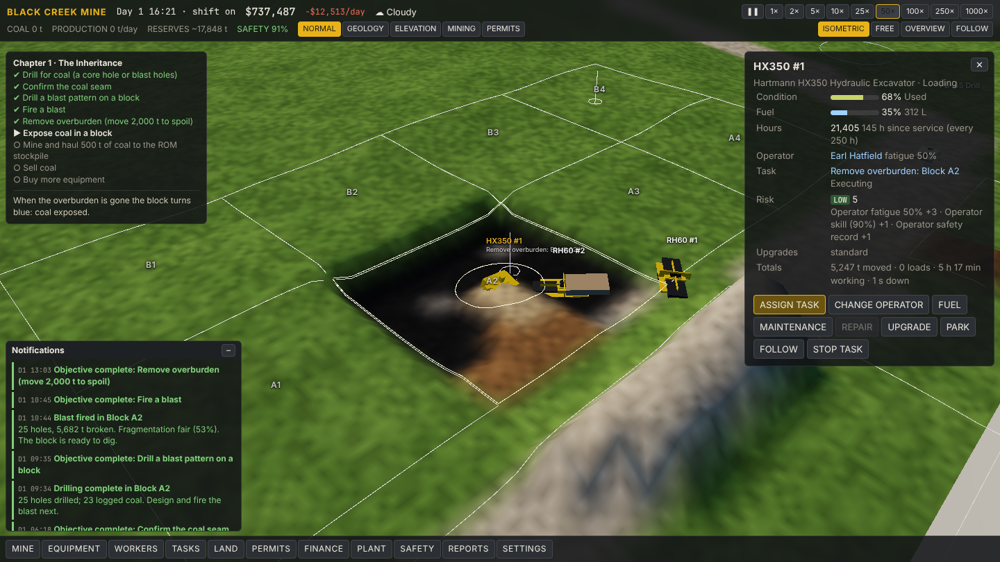

# Black Creek — Coal Mine Simulator

A surface coal mine simulator built on [Forge-Engine](https://github.com/iant89/Forge-Engine). You
inherit your grandfather's small mine on the Black Creek seam: old machines, eight loyal hands,
permits that need attention and a seam he swore runs shallow along the east ridge.

The design is in [`docs/GAME_DESIGN_SPEC.md`](docs/GAME_DESIGN_SPEC.md). This repository
implements its **first vertical slice** (spec §69 / §85): explore, drill, blast, strip overburden,
expose and mine coal, haul it, sell it, buy more equipment. The mine is a deterministic simulation;
the 3D world is a view of it.



## Run it

The game consumes Forge-Engine from a sibling checkout (the same way the engine's own demo does),
so clone both side by side:

```sh
git clone https://github.com/iant89/Forge-Engine
git clone https://github.com/iant89/coalmining
(cd Forge-Engine && npm ci)      # the engine's own dependencies
cd coalmining && npm install
npm run dev                      # http://localhost:5180
```

Set `FORGE_ENGINE_DIR` to use an engine checkout somewhere else. A browser with WebGPU is required
(current Chrome, Edge or Safari).

URL options: `?new=1` ignores the autosave, `?seed=N` generates a different mine,
`?quality=low|medium|high` scales shadows/SSAO/clouds, `?dev=1` enables the developer panel
(backtick toggles it), `?speed=N` starts at that time multiplier.

## Playing the slice

1. **Find the coal.** Two purple posts mark your grandfather's old holes. Click open ground (or use
   *MINE → DRILL EXPLORATION HOLE*) to core a hole; press **G** for the geology overlay — only what
   your holes have measured is shown.
2. **Remove overburden.** Click **Block A2** and press **REMOVE OVERBURDEN**. That one order drills a
   blast pattern, fires the blast once the 90 m zone is clear (08:00–17:00, not in fog or heavy
   rain), then digs with the excavator while both trucks haul to the east spoil dump.
3. **Mine coal.** When the block turns blue (coal exposed) press **MINE COAL**. Coal goes to the ROM
   stockpile, with recovery losses and any blast damage.
4. **Sell.** *FINANCE → SELL COAL*. Weathered coal near the outcrop is dirty — only the power
   station will take it. Deeper blocks are cleaner but cost more to uncover.
5. **Grow.** Buy another truck, hire operators, fit upgrades, keep machines serviced.

Everything can also be done by hand: select a machine and **ASSIGN TASK** (the dialog validates
before assignment and explains every problem).

Controls: left-drag pan · right-drag orbit · wheel zoom · WASD pan · Q/E rotate · R/F tilt ·
Space pause · 1–9 speed · G geology · Esc close.

## Scripts

| Command | What it does |
| --- | --- |
| `npm run dev` | Vite dev server for the game |
| `npm run verify` | architecture lint + both typechecks + the simulation tests — run before committing |
| `npm test` | 24 deterministic simulation tests (Node, no GPU) |
| `npm run lint:arch` | the simulation must not import the engine/DOM, use `Math.random` or read the clock |
| `npm run check:browser` | real WebGPU in headless Chromium: plays the slice through the UI, writes `tools/shot-*.png` |
| `npm run build` | production bundle in `dist/` |

`check:browser` uses the Chromium + SwiftShader that Forge-Engine's `npm run setup` provisions and
exits 2 (not run) without one. A green `verify` says nothing about rendering — run the browser
check and look at the screenshots.

## Layout

```
src/sim/        the simulation — authoritative, deterministic, no engine imports (spec §51)
  core/         clock (5 s ticks), RNG, domain events
  world/        terrain heightfield, geology (true vs known), materials
  tasks/        the task system: service (lifecycle, validation, assignment) + executors
  mining/       blocks, exploration, drilling, blasting, excavation
  equipment/    data-driven catalog, movement, fuel/wear/breakdowns
  workforce/    shifts, fatigue, qualifications, payroll
  logistics/    road network routing, dumps, stockpiles
  economy/ regulatory/ environment/   market, permits, safety, weather
  commands.ts   every player/developer action
  scenario.ts   scenario data → SimState;  save/save.ts  versioned save format
src/game/       the browser game on Forge-Engine: terrain/equipment/world views, camera, UI
src/data/       equipment, upgrades and scenario definitions (JSON)
tests/          simulation tests (node:test)
tools/          lint-arch.mjs, browser-check.mjs
docs/           design spec, architecture, roadmap
```

See [`docs/ARCHITECTURE.md`](docs/ARCHITECTURE.md) for how it fits together and
[`docs/ROADMAP.md`](docs/ROADMAP.md) for what is built against the spec's phases.
